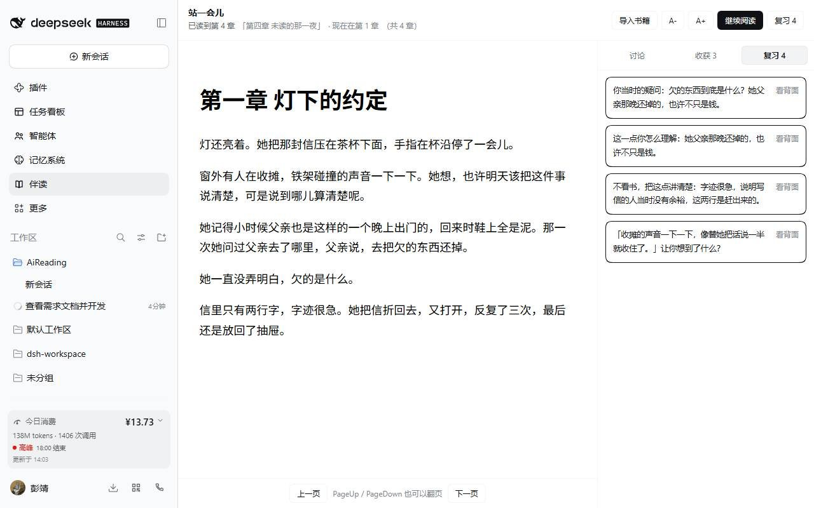

<div align="center">

# 伴读 · dsh-reading-companion

**只聊你读过的部分。**

一个把「阅读进度」当硬坐标的 DSH 伴读插件：就着你已经读过的文字追问你、帮你想清楚，再把讨论收成能跳回原文的东西。它不替你把书读了。

[](https://github.com/awesome-dsh-plugin/awesome-dsh-plugin)
[](./LICENSE)
[](./package.json)

</div>


```bash
dsh plugin --profile desktop add "github:OtakuP417/dsh-reading-companion"
```

装完刷新页面：左侧边栏多一个书本图标，点开是占满主区的「伴读」页。

## 它和「整本书摘要 + 自由问答」哪里不同

| | 常见的读书插件 | 伴读 |
| --- | --- | --- |
| 模型看到什么 | 全书正文，靠提示词"请不要剧透" | **只有你读到的章节**：未读章节的原文与摘要根本不在上下文里 |
| 防剧透靠什么 | 提示词承诺 | 检索入口与工具入口**函数级拒绝**，还有一层同步兜底门；未读块压根不进索引 |
| 位置怎么记 | 百分比 / 字符偏移（换字号就漂） | EPUB **CFI**（划线、笔记、收获、卡片共用同一个锚点） |
| 默认动作 | 给你总结 | **反问你**：先复述你的预设，再给一个具体的、能马上回答的追问 |
| 复习 | 依赖模型出题 | 纯规则出卡 + SM-2 排期，**没有模型也照常复习** |

## 它守住的五条线

1. **进度是唯一坐标。** 一本书只有一份可信进度（`sectionIndex` = 已读到第几章，只增不减），提示词里的可读边界、检索范围、摘要生成上限、进度门判断，全部从这一个数派生。往回翻不会把自己读过的章节重新藏起来。
2. **防剧透是硬门，不是提示词里的承诺。** 任何读取未读原文的入口（工具入口、HTTP 入口）都先过 `src/shared/spoiler.js` 的 `gateTarget/requireReadable`；未读章节的原文**根本不在**检索索引里（`context.js` 用 `filterReadable` 建索引）。此外还有一层同步的 `tools.guard`，用原始参数在工具执行前再拦一次。
3. **锚点用 EPUB CFI。** 划线、笔记、收获、卡片都带 `cfi`，不用百分比（百分比会随字号和窗口漂移）。
4. **AI 的默认动作是提问。** 解释性/评价性问题：先用一句话复述读者的预设，再给一个具体、能马上回答的追问；只有事实型问题才直接答，答完仍以轻追问收尾。
5. **复习不依赖模型。** 收获 → 卡片是纯规则（`src/shared/cards.js`），排期是 SM-2（`vendor/supermemo2`，MIT，只做适配）；模型只在读者主动点"换一种问法 / 拆小一点 / 和另一张对比"时参与。

## 三个面板

讨论收尾时按「本章收口」，它只拿**你自己的收获**复盘这一章，不回头重读原文：


复习面板不做测验打分，动作只有一个——**看一眼，决定要不要重读**：



回忆不起来就点「回到原文」，落回 foliate-js 里那句话的位置。

## 安装

```bash
dsh plugin --profile desktop add "github:OtakuP417/dsh-reading-companion"
```

装完后刷新 GUI：左侧边栏会多出一个书本图标，点开就是「伴读」整页（不再占用会话里的页签）。数据落在 `$DSH_HOME/reading-companion/`（默认 `C:\Users\<你>\.dsh\reading-companion\`）。

### 换一台电脑装

一条命令就够，**不需要**在那台机器上装 Node、跑 `npm install` 或 `npm run build`——`lib/` 里是预构建产物，已经在仓库里：

```bash
dsh plugin --profile desktop add "github:OtakuP417/dsh-reading-companion"
```

前置条件只有两个：

- DSH 版本满足 `engines.dsh`（`>=0.2.0-rc.1 <0.3.0-0`），不满足会在装之前就被拦下；
- 能访问 `github.com`（`dsh plugin` 内部用 pnpm 拉源码包）。

`dsh` 不在 PATH 里时用桌面版的启动器（Windows 上是
`"C:\Program Files\DeepSeek Harness\resources\runtime\cli\bin\dsh.cmd"`，
随安装位置而变）；profile 名字也要对上——桌面版是 `desktop`，Web 部署可能是 `web`。

### 离线 / github 连不上

插件不依赖任何在线服务（只有模型对话需要），所以本地目录安装同样完整：

1. 仓库页 → **Code → Download ZIP**（或 `git clone`）→ 解压；
2. `dsh plugin --profile desktop add "D:\解压出来的\dsh-reading-companion-main"`。

这就是开发时的 `link:` 安装：目录里的改动下次加载即生效，适合改代码。

### 更新 / 卸载

```bash
# 更新：再跑一次同一条 add，会拉到最新 main
dsh plugin --profile desktop add "github:OtakuP417/dsh-reading-companion"

# 卸载
dsh plugin --profile desktop remove dsh-reading-companion
```

**Host 侧没有热重载**：`lib/index.js` 是 ESM，Node 按路径缓存模块，`remove` + `add`
在同一进程里也可能拿到旧模块。改过代码或更新插件之后，**重启应用**最稳；
只改了 `lib/client.js` 刷新页面即可。

### 带着阅读数据换机器

进度、笔记、收获、卡片、复习记录全在数据根目录：

```
Windows: %USERPROFILE%\.dsh\reading-companion\
macOS / Linux: ~/.dsh/reading-companion/
```

整份拷过去就能接着读（纯 JSON / JSONL，没有数据库、没有锁）。只想同步进度的话，
拷 `progress/` 一个目录也够。

## 支持的格式

| 格式 | 怎么读 | 说明 |
| --- | --- | --- |
| EPUB | 原样渲染 | CFI 原生可用 |
| MOBI（PalmDOC / HUFF-CDIC） | 抽文字 → 重排成 EPUB | 不带图片；KF8/AZW3 明确拒绝 |
| FB2 / FBZ | 按 `<section>` 拆章 → 重排 | 嵌套章节按文档序展平 |
| TXT / Markdown / HTML | 按标题或 `第 N 章` 拆章 → 重排 | GB18030 / Big5 自动回退 |
| CBZ（图片书） | 每页一节，图片随书 | 没有文字，面板会说清楚"不能讨论" |
| PDF / AZW3 | **拒绝并给理由** | 见「已知限制」 |

除 EPUB 以外的格式都会先规整成一本自己生成的 EPUB（`src/host/epub-build.js`），再走同一条渲染 / 索引 / CFI / 进度门管线——因为阅读器和索引器必须对"第 3 章"指同一段文字，否则进度门比较的是两本不同的书。

## 目录

```
src/shared/     纯逻辑，无 DSH 依赖，可直接 node:test
  cfi.js        EPUB CFI 解析 / 比较 / 由章节号造 CFI
  spoiler.js    进度门：gateTarget / requireReadable / filterReadable
  retrieval.js  切块、CJK 分词、BM25、字 n-gram 哈希向量、HybridIndex
  scheduler.js  封装 vendored SM-2；日志 replay 出排期
  cards.js      收获 → 1~3 张原子卡片（纯规则）
src/host/       Host 半边
  store.js      数据根、原子写（tmp+rename）、JSONL 追加
  zip.js        EPUB 用的 ZIP 读取（无第三方依赖）
  zip-write.js  生成规整 EPUB 用的 ZIP 写入（含 crc32）
  epub.js       OPF / spine / NCX / nav → 按 spine 的纯文本章节
  epub-build.js 由纯文本章节 / 图片页生成一本合法 EPUB3
  formats/      各格式解析与归一：index.js（识别+分发）、text.js（TXT/MD/HTML）、
                fb2.js、mobi.js（PalmDOC/HUFF-CDIC，移植自 foliate-js）、cbz.js
  books.js      书库：导入、切块、进度、摘要、笔记、收获、卡片、复习
  context.js    已读索引缓存、章节摘要索引、选中句 ±300 字窗口、检索
  summaries.js  每章 ≤120 字摘要，只生成到读者当前章，异步不阻塞
  tools.js      暴露给模型的工具（每个入口自己加门）
  guard.js      同步兜底门（工具执行前按参数拒绝）
  routes.js     /__reading/* HTTP 面（阅读面板用）
  model.js      模型路由与流式取文本
  guidance.js   伴读人格 / 上下文块 / 收口
src/client/      Client 半边（React，仅 require('react')）
  reader.js     foliate-js 封装：CFI 恢复、relocate、选中、划线、字号
  app.jsx       阅读面板：正文 + 讨论 / 收获 / 复习
  index.jsx     左侧边栏图标（sidebar.panellist）+ 主区整页（main）+ 样式
vendor/         foliate-js（MIT）、supermemo2（MIT）、polyfill 占位
test/           node:test，全程不需要 DSH 运行时
scripts/        三个验收脚本：构建产物自检、客户端产物挂载自检、真实 Host 上的 18 条检查
```

## 开发

```bash
npm install       # esbuild + 自检用的 react（产物里 react 仍是 external）
npm run build     # lib/index.js + lib/client.js
npm test          # node --test "test/*.test.js"（58 条）
npm run verify:bundle   # 拿构建产物本身跑一遍门与路由
npm run verify:client   # 在 Node 里挂载客户端产物，确认两个席位都能渲染
```

`lib/client.js` 是单文件产物，`react` 保持 external（由平台模块表提供）。

**Host 代码没有热重载。** `dsh plugin add` 覆盖同一个包不会换掉已加载的 ESM
模块（Node 按路径缓存），`remove` + `add` 也不保证生效。改完 Host 侧代码要换新进程：
重启桌面应用，或用另一个 profile 另起一个 `dsh --profile <name> --no-open --port 0`。
Client 侧产物（`lib/client.js`）刷新页面即可。

真实安装路径上的验收记录与重跑方式见 `../docs/verification.md`：
单测 58 条、构建产物 12 条、客户端挂载 1 条、真实 Host 18 条（含未读锚点被拒、
已读锚点可溯源、摘要只到读者当前章、卡片与排期、断模型时复习照常、7 种格式导入）。

## 数据布局

```
<data root>/
  state.json                  当前打开的书
  books/<id>/meta.json        标题、章节表、原始格式（format/warnings/originalName）
  books/<id>/sections.json    按 spine 的纯文本
  books/<id>/chunks.json      检索块（带 sectionIndex 与 cfi）
  books/<id>/summaries.jsonl  每章一条摘要（追加）
  books/<id>/source.epub      导入的文件（非 EPUB 的就是规整后的 EPUB）
  progress/<id>.json          唯一进度：{ cfi, sectionIndex, positionSectionIndex, ... }
  notes/<id>.jsonl            划线/笔记（追加）
  takeaways/<id>.jsonl        收获（追加）
  cards/<id>.jsonl            卡片（派生，按内容哈希去重）
  reviews/<id>.jsonl          复习记录（追加；排期由它 replay 得出）
```

所有日志只追加，不合并、不删除；排期是日志的纯函数，所以"不删"和"能排期"不冲突。

## 已知限制

- 面板文案是中文硬编码（侧栏标题与插件元信息走 locale 服务，面板内部没有做双语）。
- **PDF 不支持**：foliate-js 1.0.1 没有 PDF 渲染器，所以 PDF 会被明确拒绝而不是给出半成品阅读体验。
- **AZW3/KF8 不支持**：它的正文是碎片索引（FDST/FRAG），要正确组装得把整套 KF8 逻辑搬过来；目前明确报错并建议转成 EPUB 或旧版 MOBI。新旧混合的 MOBI 读 MOBI6 那一半。
- MOBI 只取文字，图片不随行；CBZ 是纯图片书，面板会提示"没有文字可以讨论"。
- 检索用的是 BM25 + 字 n-gram 哈希向量（离线、零依赖），不是真正的 embedding 模型。`HybridIndex` 已经接受预先算好的 `chunk.embedding`，要换真向量只需在索引构建时把向量塞进去，但这条路径没有接线上，也没有配置项。
